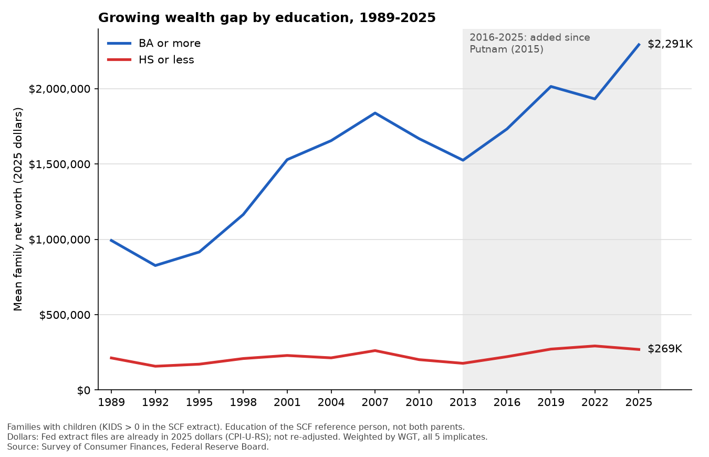

# Wealth gap by education, SCF 1989-2025

Reproduces a figure of family net worth for families whose head has a college
degree (BA or more) versus a high school education or less, 1989-2025.



## What the figure shows

- **Measure:** weighted mean (default) or median family net worth, in 2025 dollars.
- **Families:** families with children in the household (`KIDS > 0`). Use `--families all` for every family.
- **Education:** of the SCF reference person (head of household), not both parents. `EDCL == 4` is "BA or more"; `EDCL` 1-2 is "HS or less". "Some college" is left out.
- **Weights:** `WGT` on all five imputation implicates.
- **Dollars:** the Fed's extract files are already in 2025 dollars (CPI-U-RS), so nothing is re-adjusted.

## Data

Federal Reserve Board, Survey of Consumer Finances, Summary Extract Public Data:
<https://www.federalreserve.gov/econres/scfindex.htm>. One CSV per survey
(`scfp{year}excel.zip`) for 1989, 1992, ..., 2022, 2025 (the 2025 survey was released Oct 9, 2026).

Two extra files are used only for checking, and are not needed for the figures:
`scf2025_tables_public_real_historical.xlsx` (the Fed's published tables) and
`scf2025rw1s.zip` (replicate weights, used for margins of error).

## Rerun

```bash
pip install pandas matplotlib openpyxl pypdf
python get_data.py                    # downloads the 13 extract files into data/
python plot.py                        # figure_mean_kids.png
python plot.py --measure median       # figure_median_kids.png
python plot.py --families all         # all families
python margin_of_error.py             # 95% CIs; needs data/p25_rw1.dta from scf2025rw1s.zip
```

`plot.py` also writes the plotted numbers to `figure_data_*.csv`.

## Caveats

- Cross-sections, not the same families over time; no confidence bands on the figures.
- The head's own parents' education is not in the SCF.
- `data/` is about 400 MB and is not committed (see `.gitignore`).
